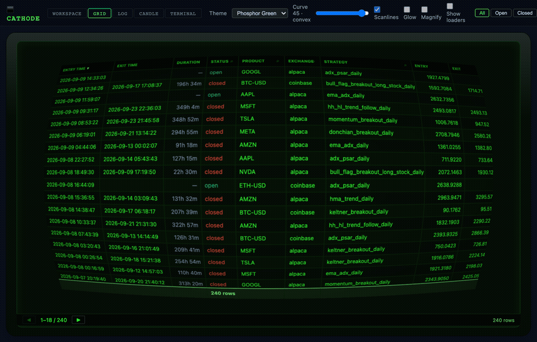
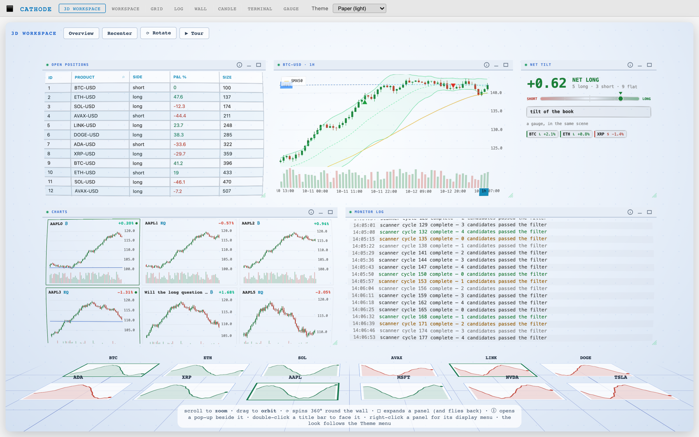
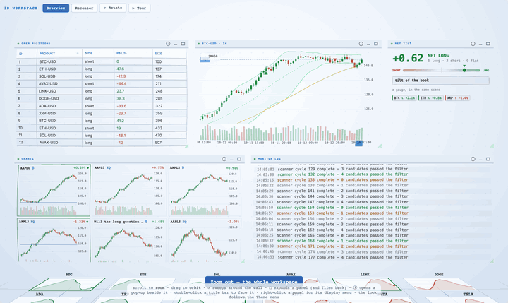
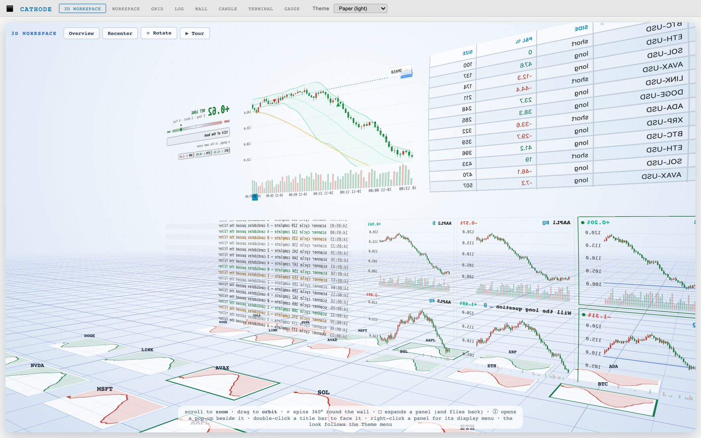
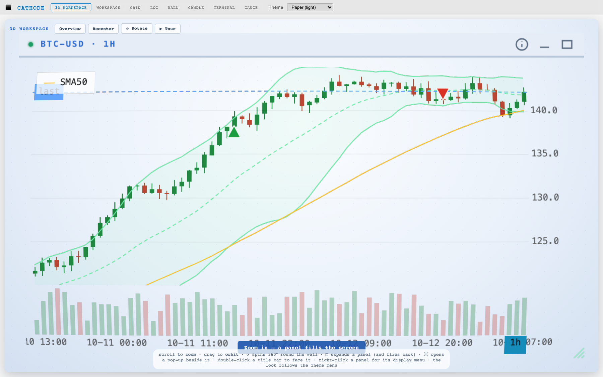
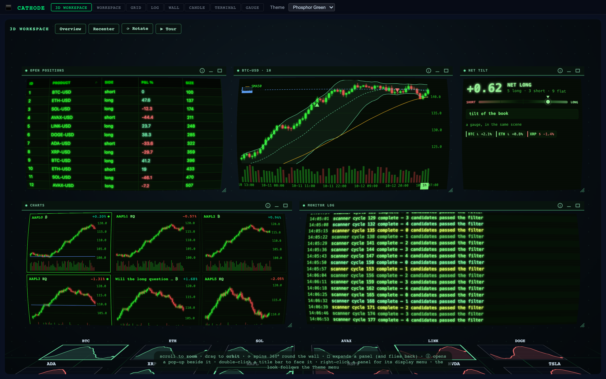

# cathode

> A retro CRT curved-screen datagrid for the web.
> Barrel-distorted columns, phosphor aesthetics, more data per viewport.

[](https://www.npmjs.com/package/@hetalhouse/cathode)
[](LICENSE)
[](https://bundlephobia.com/package/@hetalhouse/cathode)
[](https://www.npmjs.com/package/@hetalhouse/cathode)




<sup>Curvature is **signed** (−45…45): positive bulges convex like a CRT tube, negative dishes concave — the panel wraps around a focal point like a room. Sweep reproduces with `npm run capture:bend`. Header filter popups are drawn in-canvas, so they bend too.</sup>

**[▶ Try it live](https://bradyhouse.github.io/cathode/)** — opens on the 3D workspace; the curve slider is the fun part on the Grid tab.
**[🎬 Watch the 26-second tour (mp4)](https://github.com/hetalhouse/cathode/raw/main/docs/demo.mp4)** — workspace → magnifier lens → three.js candles → themes.

<sup>Stills reproduce with `npm run capture:hero` (see `tools/capture-hero.mjs`); the workspace hero lives at [`docs/hero.png`](https://raw.githubusercontent.com/hetalhouse/cathode/main/docs/hero.png).</sup>

---

## 3D workspace — zoom in, zoom out

Every widget can hang as a panel in **one three.js scene**, and the camera becomes the interface: scroll to **zoom**, drag to **orbit**, press **□** and a panel is *expanded* — the camera flies in until it fills the view, and **□ again flies back out** to the view you had — **ⓘ** opens a pop-up that joins the wall in a free spot (the camera flies to it, and back when you close it), **Overview** zooms the whole workspace out until everything is in frame, and **⟳ Rotate** spins the camera a **full 360°** round the wall — so you see the **scape of live chart tiles** that lies on the floor in front of it *and behind it*, like a trading dashboard's 3D scene. **▶ Tour** plays all of it. Four themes from one drop-down (Default · Phosphor · Amber · Paper), re-dressed live — panels, title bars, menu, backdrop and the floor grid under the workspace.











**[▶ Open the 3D workspace](https://bradyhouse.github.io/cathode/)** — it is the demo's front door; **▶ Tour** plays the fly-in, fly-out, pop-up and the 360° spin for you. Stills and the sweep reproduce with `npm run capture:workspace`.

```ts
import { OrbitControls } from 'three/addons/controls/OrbitControls.js'
import { CathodeStage3D, gridContent, candleContent } from '@hetalhouse/cathode'

const stage = new CathodeStage3D({
  container: el, transparent: true,
  controls: (camera, dom) => new OrbitControls(camera, dom),
  barStyle: 'cockpit',                                   // title bars like a desktop's windows
  onPanelControl: (id, c) => c === 'maximize' && stage.flyTo(stage.facingPose(id, { margin: 0.03 }), 700),   // □ = expand
})
stage.addPanel({ id: 'trades', title: 'Open positions', content: gridContent({ width: 560, height: 320, columnDefs, rowData, theme: 'paper' }),
  position: [-0.9, 0, 0], controls: ['minimize', 'maximize'] })
// …more panels…
await stage.flyTo(stage.framePose(), 800)                // Overview — zoom out until every panel is in frame
await stage.flyTo(stage.facingPose('trades'), 700)       // zoom in on one
```

Full API below: [**In 3D space — `CathodeStage3D`**](#in-3d-space--cathodestage3d). A standalone **three.js example** — one HTML file, an import map, no build step — is in [`examples/threejs-workspace.html`](https://github.com/hetalhouse/cathode/blob/main/examples/threejs-workspace.html).

---

## Why

Flat datagrids waste peripheral vision. A curved screen — like a real CRT monitor — angles the
left and right columns toward the viewer, creating a panoramic effect that lets you read more
columns comfortably without horizontal eye strain. Edge columns are slightly foreshortened,
fitting 10–15% more content at the same viewport width.

The effect is pure CSS 3D (`perspective` + `rotateY` per column). Text stays real DOM —
selectable, copyable, accessible.

---

## Quick start

```bash
npm install @hetalhouse/cathode
```

Minimal — drop a grid into a Vue 3 app:

```vue
<script setup lang="ts">
import { CathodeGrid, type ColDef } from '@hetalhouse/cathode'
import '@hetalhouse/cathode/style'

const cols: ColDef[] = [
  { field: 'ticker', headerName: 'Ticker' },
  { field: 'price',  headerName: 'Price'  },
]

const rows = [
  { ticker: 'BTC', price: 67_341.20 },
  { ticker: 'ETH', price: 2_481.05  },
]
</script>

<template>
  <CathodeGrid :column-defs="cols" :row-data="rows" theme="phosphor" />
</template>
```

That's it. The grid renders, the curve activates, the phosphor glow lights up.

<details>
<summary>Comprehensive example — API callback, pagination, custom styling</summary>

```vue
<script setup lang="ts">
import { CathodeGrid } from '@hetalhouse/cathode'
import '@hetalhouse/cathode/style'
import type { ColDef, GridApi } from '@hetalhouse/cathode'

const cols: ColDef[] = [
  { field: 'ticker',   headerName: 'Ticker',  width: 90 },
  { field: 'price',    headerName: 'Price',   width: 100, cellStyle: { textAlign: 'right' } },
  { field: 'pnl',      headerName: 'PnL %',   width: 80  },
]

let api: GridApi

function onGridReady(e: { api: GridApi }) {
  api = e.api
  api.setGridOption('rowData', myRows)
}
</script>

<template>
  <CathodeGrid
    :column-defs="cols"
    :row-height="28"
    theme="phosphor"
    :curvature="12"
    :scanlines="true"
    :glow="true"
    :pagination="true"
    :pagination-page-size="50"
    @grid-ready="onGridReady"
    @row-clicked="e => console.log(e.data)"
  />
</template>
```

</details>

---

## Status

**v0.1.x — production-ready for small-to-mid datasets.** Cathode is in active use rendering live trading data in a production dashboard.

| Works well for | Choose something else for |
|----------------|---------------------------|
| 100s–10ks of rows | 100k+ rows (use [TanStack Table](https://tanstack.com/table) — virtual scrolling is on cathode's roadmap but not yet shipped) |
| Vue 3 apps | React (no wrapper yet — see [ROADMAP.md](https://github.com/hetalhouse/cathode/blob/main/ROADMAP.md)) |
| Dashboards, status panels, sci-fi UIs | Spreadsheet-style apps with row grouping / aggregation (not yet shipped) |
| Built-in CRT / phosphor aesthetic | Plain Material / Tailwind look — pass `theme="none"` and bring your own CSS vars |

See [`ROADMAP.md`](https://github.com/hetalhouse/cathode/blob/main/ROADMAP.md) for what's coming next.

---

## Props

| Prop | Type | Default | Description |
|------|------|---------|-------------|
| `columnDefs` | `ColDef[]` | required | Column definitions |
| `rowData` | `any[]` | `[]` | Initial row data (use `api.setGridOption('rowData', …)` to update) |
| `rowHeight` | `number` | `28` | Row height in px |
| `defaultColDef` | `Partial<ColDef>` | `{}` | Merged into every column definition |
| `getRowStyle` | `(p) => CSSProperties` | — | Per-row inline style callback |
| `pinnedBottomRowData` | `any[]` | — | Rows pinned to the bottom of the scroll area |
| `pagination` | `boolean` | `false` | Enable pagination bar |
| `paginationPageSize` | `number` | `50` | Rows per page |
| `theme` | `'none' \| 'phosphor' \| 'amber' \| 'paper'` | `'none'` | Built-in colour theme (`'none'` inherits parent CSS vars) |
| `curvature` | `number` | `10` | Screen bend, `-45`–`45`: positive = convex (CRT bulge), negative = concave (dish), `0` = flat |
| `bendField` | `boolean` | `true` | The bend buys field-of-view: the content canvas widens by what the warp absorbs (+54% at −45), so bending slides more columns in |

Also in the family: **`CathodeCandleGrid`** — a wall of N mini candle charts rendered in ONE WebGL context (cells composite into a single warped sheet; `cell-click` routes through the barrel inverse; bend-field slides more cells in as the wall bends). See the demo's WALL tab.

And **`CathodeGauge`** — a bipolar gauge through the same pipeline: a readout (big figure + `stance` + `sub`), a needle on a `leftLabel`↔`rightLabel` axis that eases to each new `value` on `[min, max]`, then an optional boxed `caption`, a dim `note` and a wrapping row of `items` chips (`{ label, side: 'left' | 'right', value, tone }`, lettered by `sideLetters`) — the shape of a long/short book's net-tilt read-out, one chip per position. `marks` draws labelled ticks on the axis (a second hurdle, a danger line) and `meter` a secondary bar under it — a filled track on `[min, max]` with threshold ticks, a label row and the value at the right (a margin guard, say). `colors` overrides the pole colours (e.g. your P&L up/down), `animate: false` snaps the needle; `emptyText` stands in for an empty `items`. Same `theme` / `curvature` / `scanlines` / `glow` / `magnify` as the rest. See the demo's GAUGE tab.

| `perspective` | `number` | `1400` | CSS perspective distance (px) — higher = subtler vanishing point |
| `scanlines` | `boolean` | `true` | Overlay repeating scanline gradient |
| `glow` | `boolean` | `true` | Apply `text-shadow` phosphor glow to cell text |

### In 3D space — `CathodeStage3D`

Every widget can also live as a **panel in one three.js scene** instead of a CSS window: one renderer, a perspective camera, panels that tilt, overlap and recede, and input by raycast.

```ts
import { OrbitControls } from 'three/addons/controls/OrbitControls.js'
import { CathodeStage3D, gridContent, surfaceContent, CathodeSurface } from '@hetalhouse/cathode'

const stage = new CathodeStage3D({
  container: el,
  controls: (camera, dom) => new OrbitControls(camera, dom),   // injected — the library doesn't bundle three/addons
})
const grid = gridContent({ width: 640, height: 400, columnDefs, rowData })   // headless GridModel + surface
stage.addPanel({ id: 'trades', title: 'Trades', content: grid, position: [-0.8, 0, 0], rotationY: 0.2, look: { curvature: 12 } })
```

- A panel is a **`CathodeSurface`** (`mode: 'world'`) plus a **`PanelContent`** that hears pointer events in the surface's own logical px. `gridContent()` binds the headless **`useGridModel`**; a painter-only widget (a gauge) is `surfaceContent(surface, w, h)`.
- The stage maps a raycast hit's UV through `CathodeSurface.contentPoint()` — the CPU mirror of the CRT warp — so clicks land on the pixel actually drawn. Drag a title bar to move a panel (ray–plane on its own plane); drag empty space to orbit; wheel over a grid scrolls it, elsewhere zooms; the pressed panel takes keyboard focus and is raised. `getLayout()` / `applyLayout()` save and restore positions.
- The grid's filter popup is typed into directly (there is no DOM input in 3D). Rendering is on demand.
- **Overlay mode** — lay a stage over *another* three.js scene instead of owning the view: `transparent: true` (alpha canvas), `fov` / `near` / `far` to match that scene's camera, `stage.setCameraPose({ position, target })` to follow it (so panels share the scene's 3D space), and `passThrough: true` — the canvas takes no pointer events; the stage listens on `inputTarget` (capture, `document` by default), a press / click / wheel over a panel is handled and stopped, and anywhere else it falls through to the scene beneath (its orbit, its plane clicks). `shouldHandle(target)` excludes DOM stacked above the stage; `onCursor` routes cursor changes to the host; keys go to the focused panel from `window` (not while typing in an input).
- **`gaugeContent()`** — the gauge as a stage panel: the same picture `CathodeGauge` draws (readout, needle on a left↔right axis, `marks`, `meter`, caption, note, item chips), with the needle EASING to each new value and sweeping in from centre on mount. Read-only. `panel.content.update({ value, caption, items, … })` pushes new data; `.shown` is the needle's animated position. (`drawGauge` and `GaugeDrawOpts` are exported too, for a host that wants to paint a gauge into its own canvas.)
- **`logContent()`** — a log as a stage panel, on the headless **`useLogModel`** (the same model `CathodeLog` now runs on): the entries wrapped to the panel's width, wheel / drag-pan scrolling, **follow-the-tail** (a log that is at the bottom stays there as entries arrive; one you scrolled up doesn't jump), hover, click / shift-click line selection, arrows / page / home / end, Cmd+A and **Cmd+C** (copies the ENTRIES — timestamp + text, wrapped fragments rejoined). `panel.content.update({ entries, theme, wordWrap, … })` swaps the data; a resize re-wraps. `useLogModel` takes canvas-space input like `useGridModel`, so any presenter can drive it.
- **`candleContent()`** — a candle chart as a stage panel, on the headless **`useCandleModel`** (the model `CathodeCandle` now runs on): the OHLCV candles with volume, `overlays` (lines, bands, horizontal order lines) and trade `markers`; the **hover crosshair + readout**, **wheel zoom anchored on the candle under the cursor** (bounded 0.25–6×), shift-wheel / trackpad scroll, drag-pan, ←/→ pan, ↑/↓ zoom, Home / End; anchored on the newest candle. `panel.content.update({ candles, overlays, markers, theme, slotW, … })` swaps the data; a resize re-fits the chart (more room, more candles). Like `useGridModel` / `useLogModel` it takes canvas-space input, so any presenter can drive it.
- **Grid view state in `GridApi`**: `getSortModel()` / `setSortModel([{ colId, sort }])` (unlike `applyColumnState`, `[]` *clears* the sort) and `getScrollY()` / `setScrollY(y)` (clamped; applied after the pending sort / filter / data updates, which reset the scroll to the top — so it is safe to call straight after them). With `getFilterModel()` / `setFilterModel()` and `getColumnState()` / `applyColumnState()` a host can carry a grid's whole view between two instances — e.g. a 2D window and its 3D stage panel.
- **Themeable title bars + the ⓘ control.** `barColors` (a `BarColors` palette: fill, bottom rule, text, action outlines, accent, …) and `barStyle: 'plain' | 'cockpit'` on the stage, live via **`stage.setBarColors()`** / **`setBarStyle()`** — a host re-themes every bar when its theme changes. `'cockpit'` is what a dashboard's 2D windows wear: a glowing status dot, then a small, bold, tracked **UPPERCASE** title. `PanelControl` gains **`'info'`** (an ⓘ; reported through `onPanelControl`, its meaning is the host's — e.g. a help panel). **`stage.setMenuColors()`** re-themes the in-scene Display menu live. Everything is opt-in: the default bar is pinned pixel-for-pixel by a golden spec (11 states).
- **`candleWallContent()`** — a **wall of mini candle charts** as a stage panel, on the headless **`useCandleWallModel`** and the pure wall maths shared with **`CathodeCandleGrid`** (`layoutWall` / `wallCellAt` / `drawWall`, exported): `cells: WallCell[]` (title · badge · note in a colour · an open-position frame + dot · candles · overlays) laid out in `floor(width / minCellW)` columns (default 210 px), each cell a compact `drawCandle` fitted to its box. Hover rings a cell, a click reports its id (`onCellClick`), the wheel scrolls a wall that overflows, a resize re-flows the columns; `panel.content.update({ cells, theme, … })` swaps the data. `CathodeCandleGrid` itself draws with the same functions (its output is pinned byte-identical by a golden spec). One fix on the way: the grid laid out on the backing store's *physical* width, which on a high-dpi screen made twice the columns of twice the width — it now lays out in logical px (identical at dpr 1).
- **Title-bar actions + close.** `actions: [{ id, label, active? }]` on `addPanel` draws small **text buttons** in the title bar, just left of the controls (a range picker's `5m 15m 1H 1D`, tabs …) with an **active** state (filled) and a hover highlight; a click is reported as `onPanelAction(panelId, actionId)` — never a drag, never the "face this panel" double-click — and what it does is the host's call (`panel.setActions(next)` moves the active mark; it repaints the bar only if something changed). The title squeezes clear of them. `controls` gains **`'close'`** (an ✕): the stage reports it as `onPanelControl(id, 'close')`, the host decides what closing means. `stage.clientPointForAction(id, actionId)` for tests / tours; `StagePick` gains `action`.
- **Display menu (in the scene).** `displayMenu: true` (or `{ colors }`, the menu's palette) on the stage: a **right-click** on a panel — body or title bar — opens a small menu **drawn on that panel's own plane**, a hair in front of it, so it tilts, bends and orbits with the panel instead of floating over the page as DOM: **Scan lines · Glow · Magnify (hover lens)** switches and a **Bend** stepper (−40 … 40, step 2). Each row changes the panel at once and is reported as `onPanelDisplay(id, { curvature, scanlines, glow, magnify })` so the host can persist it; **Cmd+Shift +/−** bends the hovered panel the same way (and reports it). A press on the menu never reaches the content beneath; a press elsewhere, Escape, or starting a drag / resize closes it; it clamps to stay inside its panel; the browser's own context menu is suppressed only over a panel. **Magnify now works on a stage panel**: with it on, the hover lens follows the pointer over that panel and lets go when it leaves (the lens has a fixed pixel radius, so keep it for panels big enough to carry it). `panel.display` / `panel.setDisplay({ … })` are the same switches in code; `stage.openDisplayMenu(id)` / `closeDisplayMenu()` / `displayMenuPanel` for tours.
- **Resize.** `resizable: true` on `addPanel` (with `minSize` / `maxSize`, default 240×160 … 1600×1000) puts a grip in the panel's bottom-right corner; dragging it resizes the panel and the **top-left corner stays put** (the panel's centre moves). The handle is **geometric** — hit-tested on the plane's UV (`pick(…).handle`), so a screen bend can't move it — and the cursor shows `nwse-resize`. The content must support it: `PanelContent.resize(w, h)` — `gridContent` re-fits its columns and viewport (more room, more columns / rows), `gaugeContent` redraws, and a custom `surfaceContent` passes its own — then the surface's backing store follows. `onPanelResized(id, size, pos)` fires once on release; `getLayout()` / `applyLayout()` carry `size` (apply the position AND the size to restore a saved arrangement); `panel.resize(w, h)` does it programmatically; a collapsed panel has no handle.
- **Title-bar controls + minimize.** `controls: ['minimize', 'maximize']` on `addPanel` draws the buttons at the bar's right edge (strokes, not font glyphs); the stage hit-tests them (`pick(…).control`), shows a hand over them, and reports a click as `onPanelControl(id, control)` — a press on a button is a button, never a drag, and never a "face this panel" double-click. **What a click means is the host's call.** The stage gives you the state: `stage.setPanelMinimized(id, v)` collapses a panel to its title bar (the body is hidden and no longer picked; `facingPose` then fits the bar alone; `layout.minimized` round-trips; the button shows "expand"), and `panel.setMaximized(v)` flips the maximize button to "restore" — typically paired with `stage.facingPose(id, { margin: 0.03 })` + `flyTo` to fill the view, and back to the remembered pose. `stage.clientPointForControl(id, control)` is there for tests and tours.
- **`panel.setTitle(text)`** changes a panel's title-bar text after it's created — for a live count (`"Open positions (6)"`) — repainting only the bar, and only when the text changed. `panel.title` reads it; a title too long for the bar is squeezed to fit.
- **Pop-ups join the wall, never land on it.** The panels are a *wall* — upright, side by side in one plane. `stage.freeSpot({ w, h }, { near?, gap?, prefer? })` is where a panel of that size fits in the wall without touching any other (the free spot nearest `near` — a detail view opens beside its parent): pure, in the wall's plane. `stage.addPopup(options, { near? })` adds the panel there, focuses it and **expands** it — the camera flies in until it fills the view. `stage.expand(id)` / `stage.unexpand()` / `stage.toggleExpand(id)` are the maximize control's meaning in one place: expand remembers the camera, and **unexpand flies back to the view you had** (expanding another panel meanwhile keeps the *original* way back); `stage.closePanel(id)` removes a pop-up and does the same. `stage.expandedId` says which panel is expanded.
- **Overview — zoom the whole workspace out.** `stage.framePose(ids?, { margin?, minDistance? })` is the camera pose that frames *several* panels at once (every title bar included), looking along their average facing — `await stage.flyTo(stage.framePose(), 800)` zooms out until everything is in view, wherever the panels were dragged; pass `ids` to frame a subset, `minDistance` so an Overview can never be a zoom *in*. Pure, like `facingPose` (it moves nothing). Together: `facingPose(id)` = **zoom in** on one panel, `framePose()` = **zoom out** to all of them.
- **Facing, activation, visibility** — `stage.facingPose(id)` is the camera pose that looks straight at a panel (title bar included) from the front, with a margin; it moves nothing, so an overlay host applies it to its own camera, and a stage that owns its camera calls `stage.flyTo(pose, ms)` (an eased tween that resolves when it lands). `onPanelActivate(id)` fires when a title bar is double-clicked — the natural hook for "face this panel". `PanelPointerEvent.detail` is the click count on `'click'` events (1, then 2), and `gridContent` forwards it as `event.detail` on `row-clicked`, so a double-click can mean something. `stage.setPanelVisible(id, v)` (or `visible:` on `addPanel`) hides a panel — not drawn, picked or focused — and `getLayout()` / `applyLayout()` carry `visible` with the position.
- Try it: `npm run dev` → `/stage3d.html` (and `/surface3d.html` for a single plane, `/stage3d-overlay.html` for overlay mode).

---

## Grid API

Emitted via `@grid-ready`. Mirrors the ag-Grid Community API surface used in typical dashboards.

```ts
api.setGridOption('rowData', rows)
api.setGridOption('pinnedBottomRowData', pinnedRows)
api.setGridOption('quickFilterText', 'BTC')

api.getColumnState()                   // → ColState[]
api.applyColumnState({ state, applyOrder })
api.setFilterModel({ status: { type: 'equals', filter: 'open' } })
api.getFilterModel()
await api.setColumnFilterModel('status', { type: 'equals', filter: 'open' })
api.onFilterChanged()                  // no-op — Vue reactivity handles it

api.refreshCells()                     // force re-evaluation (e.g. Age column)
api.exportDataAsCsv({ fileName: 'trades.csv' })
api.resetColumnState()
```

---

## ColDef

```ts
interface ColDef {
  field?:          string           // row[field]
  headerName?:     string
  colId?:          string           // explicit ID; defaults to field → headerName slug
  width?:          number
  minWidth?:       number
  sortable?:       boolean
  filter?:         boolean          // shows ⌕ icon in header → popup text filter
  resizable?:      boolean
  hide?:           boolean
  sort?:           'asc' | 'desc'   // initial sort
  sortIndex?:      number           // precedence when several columns set `sort`
  valueGetter?:    (p) => any
  valueFormatter?: (p) => string
  cellStyle?:      CSSProperties | ((p) => CSSProperties)
  cellRenderer?:   (p) => string    // HTML string rendered via v-html
  comparator?:     (a, b) => number
}
```

---

## Themes

| Theme | Background | Text | Use for |
|-------|-----------|------|---------|
| `none` (default) | inherits `--c-bg` CSS var | inherits `--c-tx1` | Drop into an existing dashboard |
| `phosphor` | `#060d06` | `#33ff33` | Classic green CRT terminal |
| `amber` | `#0a0700` | `#ffb000` | Amber phosphor |
| `paper` | `#f6f6f6` | `#222` | Light / Lumen-style |

### CSS custom properties (`theme="none"`)

If no theme is set, the grid reads these variables from its parent — making it a natural
fit alongside an existing `:root` / `html.light` token system:

```
--c-bg, --c-surface, --c-header, --c-tx1, --c-tx2, --c-tx4,
--c-border, --c-input
```

---

## Contributing

See [`CONTRIBUTING.md`](https://github.com/hetalhouse/cathode/blob/main/CONTRIBUTING.md) for development setup, the Playwright regression-test suite, and the release process.

---

## License

MIT — © Brady House
